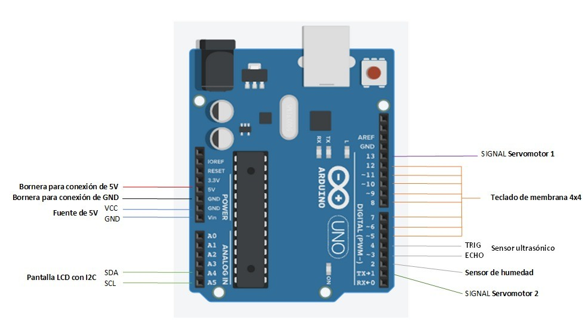

# Basurero inteligente con clasificación automática

Prototipo que **separa residuos orgánicos e inorgánicos** según su humedad, controlado por un **Arduino UNO**. Al acercar un residuo, un sensor ultrasónico lo detecta, el sensor **DHT22** mide la humedad y dos **servomotores** abren la compuerta correspondiente.

> Proyecto de Electrónica Básica — Universidad San Francisco de Quito (USFQ), 2023.

**Resultado:** clasificación correcta en el **87 %** de los casos.

## Funcionamiento

1. **Detección:** el sensor ultrasónico HC-SR04 mide la distancia continuamente. Si hay un objeto a **5 cm o menos**, se inicia el análisis.
2. **Medición:** el DHT22 mide la humedad relativa y la pantalla LCD muestra "Analizando…".
3. **Clasificación:**
   - Humedad **≥ 75 %** → **orgánico**: el servomotor 2 abre su compuerta.
   - Humedad **< 75 %** → **inorgánico**: el servomotor 1 abre su compuerta.

   Cada compuerta se mantiene abierta 5 s y vuelve a cerrarse.
4. **Pantalla:** en reposo, la LCD 16×2 muestra la humedad actual y el código que se va tecleando.
5. **Teclado 4×4:** al ingresar el código correcto y presionar `#`, se accionan ambas compuertas, por ejemplo para vaciar o hacer mantenimiento.

## Conexiones

  

| Componente | Pines del Arduino UNO |
|---|---|
| Sensor de humedad DHT22 | D2 |
| Sensor ultrasónico HC-SR04 | TRIG D4 · ECHO D3 |
| Servomotor 1 (inorgánico) | D13 |
| Servomotor 2 (orgánico) | D1 |
| Teclado de membrana 4×4 | Filas D12–D9 · Columnas D8–D5 |
| Pantalla LCD 16×2 con I2C (0x27) | SDA A4 · SCL A5 |
| Alimentación | Fuente externa de 5 V |

## Estructura

| Carpeta | Contenido |
|---|---|
| `smart_bin/` | Código de Arduino (`smart_bin.ino`) |
| `drawings/` | Planos de las piezas de la estructura (MDF de 3 mm): base, base para sensores, paredes, tapa del basurero y tapa superior |
| `docs/images/` | Esquema de conexiones |

## Requisitos

- Arduino IDE
- Librerías: **DHT sensor library** (Adafruit), **LiquidCrystal I2C**, **Keypad** y **Servo** (incluida en el IDE)

Abre `smart_bin/smart_bin.ino` en el Arduino IDE, selecciona **Arduino UNO** y sube el programa.

> Desconecta el cable del servomotor 2 del pin D1 (TX) mientras subes el programa: ese pin también lo usa la comunicación USB.

## Tecnologías

Arduino UNO · C++ · DHT22 · HC-SR04 · Servomotores · LCD I2C · Teclado matricial 4×4 · Autodesk Inventor

## Autor

**Matías Loayza Correa** — Ingeniero Mecánico, USFQ  
[Portafolio](https://mleo22d.github.io) · [LinkedIn](https://www.linkedin.com/in/matias-loayza)
